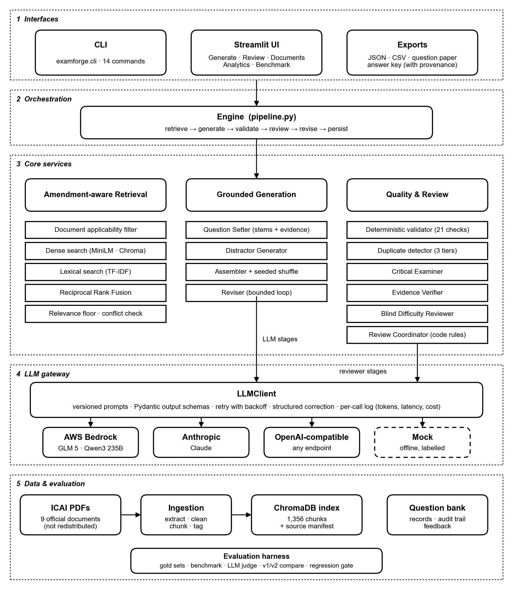
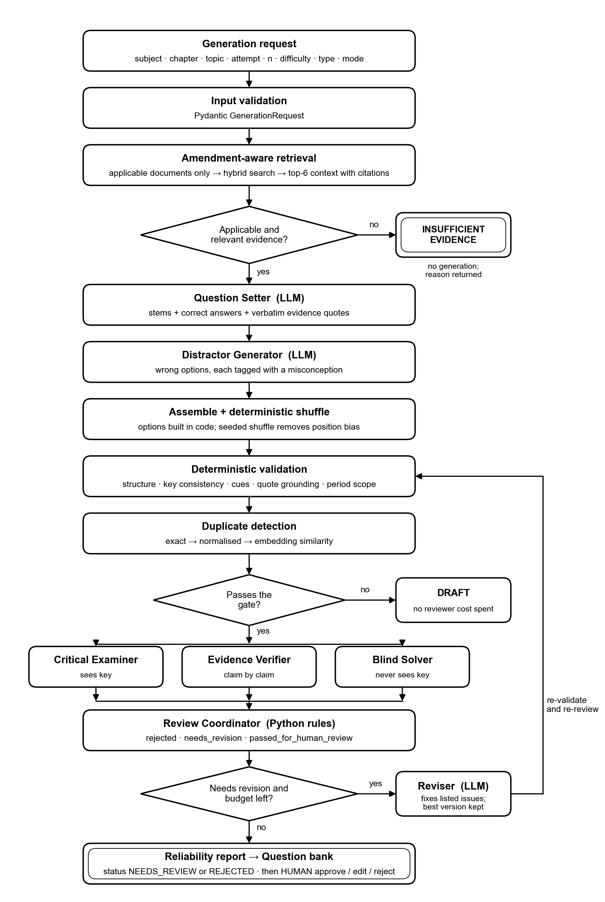
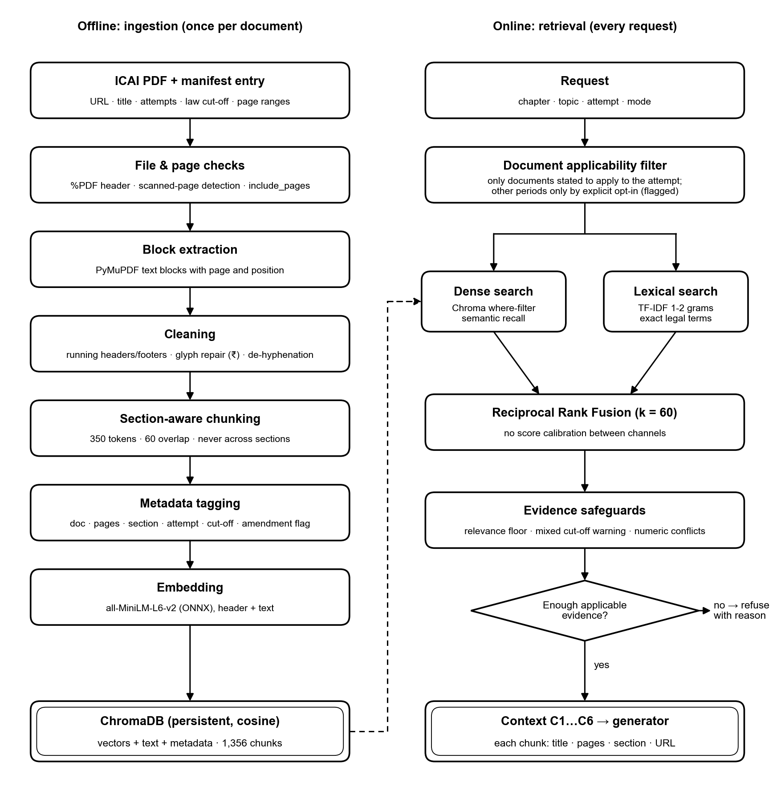
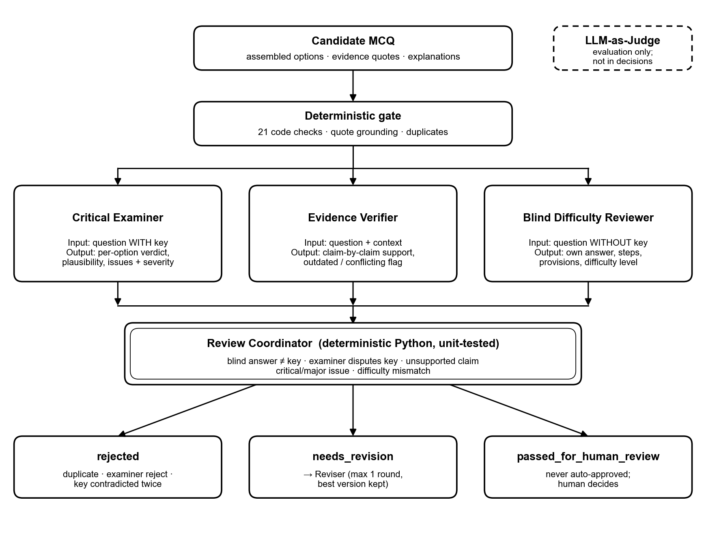
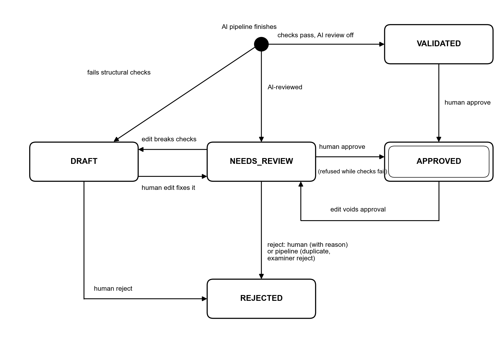

# Architecture

## Diagrams

| | |
|---|---|
| System layers |  |
| Generation pipeline |  |
| Ingestion and retrieval |  |
| Multi-agent review |  |
| Question lifecycle |  |

## Design principle

Every stage has one job, a Pydantic input/output contract, and an explicit failure mode. The model is a component
whose output is always re-checked; acceptance is decided by code; approval is decided by a person.

## Components

| Stage | Module | Input → Output | Failure handling |
|---|---|---|---|
| Input validation | `schemas.GenerationRequest`, `pipeline.generate` | user params → validated request | Pydantic errors; unknown subject/chapter → `failed` |
| Ingestion | `ingestion.py` | PDF + manifest entry → `Chunk[]` | missing file, non-PDF (`%PDF` check), scanned (`needs_ocr`), empty text, duplicate file hash - each recorded in `extraction_status`, never silently skipped |
| Indexing | `retrieval.VectorIndex` | chunks → Chroma (embedding + text + metadata) | idempotent: re-ingest deletes the document's chunks first |
| Source selection | `retrieval.select_documents` | request → allowed / historical document ids + warnings | no applicable doc → `insufficient_evidence` with the list of available periods |
| Retrieval | `retrieval.Retriever` | request → `RetrievalResult` (chunks, warnings, conflicts) | relevance floor; amendment mode with no amendment-marked chunks → refusal |
| Question Setter | `generation.generate_stems` | context + request → `StemBatch` | may return fewer/zero questions with `insufficient_context` |
| Distractor Generator | `generation.generate_distractors` | stems + context → `DistractorBatch` | count mismatches are reported to validation, not repaired |
| Assembly | `generation.assemble` | stem + distractors → `MCQ` | seeded shuffle; labels A-D |
| Deterministic checks | `validation.deterministic_checks` | MCQ + context → `CheckResult[]`, citations, grounding | error vs warning severity |
| Duplicates | `validation.DuplicateDetector` | MCQ vs bank → duplicate id / similar list | exact → normalised → embedding cosine |
| Critical Examiner | `agents.critical_examiner` | full MCQ + context → `ExaminerReview` | LLM failure → warning check; question cannot pass |
| Evidence Verifier | `agents.evidence_verifier` | MCQ + cited quotes + context → `EvidenceReview` | same |
| Difficulty Reviewer | `agents.difficulty_reviewer` | MCQ **without key** + context → `DifficultyReview` | same |
| Review Coordinator | `agents.coordinate` | checks + reviews → `Decision` | pure function; unit-tested |
| Reviser | `generation.revise` | MCQ + findings → `MCQDraft` | bounded by `MAX_REVISIONS`; worse revisions discarded |
| Reliability report | `pipeline._assess` | all of the above → `ReliabilityReport` | individual metrics kept next to the composite index |
| Human review | `review.py`, `pipeline.edit/regenerate` | human action → updated record + audit entry | approval blocked while checks fail |
| Evaluation | `evaluation.py` | gold sets / fixed cases → metrics JSON | isolated bank per benchmark run |
| Analytics | `analytics.py` | bank → coverage, distributions, feedback patterns | - |
| Export | `export.py` | bank → JSON / CSV / paper / answer key | provenance columns always included |

## Data flow

```
data/metadata/sources.json ──► ingestion ──► Chroma (data/index) + data/processed/*.jsonl (inspection only)
                                                     │
GenerationRequest ──► select_documents ──► dense (Chroma, where=document_id ∈ allowed) ┐
                                         └► TF-IDF over allowed chunks                   ├► RRF ► top-k ► C1..Ck context
                                                                                         ┘
C1..Ck ─► setter ─► distractors ─► assemble ─► [checks ─► dup ─► 3 reviewers ─► coordinator ─► (revise)] ─► bank
```

Context chunks are presented to the model as `C1..Ck` (short ids are copied more reliably than long ids). The
record stores the `C → chunk_id` map, so a human edit can be re-validated against exactly the same context.

## LLM layer

`llm.py` defines a `Provider` protocol (`generate(system, user, schema, variables) -> LLMResponse`) with three
implementations: `AnthropicProvider` (Claude, native structured outputs via `messages.parse` + Pydantic, adaptive
thinking with configurable effort, server-side refusal fallback), `OpenAICompatProvider` (JSON mode + Pydantic
validation, any OpenAI-compatible base URL) and `MockProvider`. Providers classify failures into
*transient* (backoff + retry), *output* (structured correction: the validation error is sent back) and *fatal*
(fail fast). `LLMClient.run` owns retries, prompt rendering, stage→provider routing (reviewers can use a different
model) and the JSONL call log (`data/runs/llm_calls.jsonl`: stage, prompt version, model, attempts, tokens,
latency, errors - never keys).

## Statuses

| Status | Meaning | Set by |
|---|---|---|
| `DRAFT` | fails error-level deterministic checks; not usable until fixed | pipeline / human edit |
| `VALIDATED` | passed deterministic checks, AI review disabled | pipeline |
| `NEEDS_REVIEW` | AI-reviewed; waiting for a human (verdict + flags visible) | pipeline / edit |
| `APPROVED` | educator-approved | **human only** |
| `REJECTED` | duplicate, examiner reject, contradicted answer, or human reject | pipeline / human |

Reliability *verdicts* are separate: `passed_for_human_review`, `needs_revision`, `rejected`, `insufficient_evidence`.

## Coordinator rules (deterministic)

- **rejected**: duplicate; examiner verdict `reject`; or evidence verifier says *unsupported* **and** the blind
  solver disagrees with the key (two independent signals).
- **needs_revision**: any error-level check fails; examiner `revise` or a major/critical issue; examiner disputes
  the key; evidence not fully supported; blind solver disagrees; difficulty mismatch; quote grounding < 1.
- Otherwise **passed_for_human_review**. After revisions run out, only *soft* findings (difficulty mismatch,
  warnings) may still pass to a human, with the flags shown.
- Reviewer disagreements (e.g. examiner accepts, verifier says unsupported) are recorded explicitly.

## Extending to another subject (e.g. DT)

Add a block to `config/subjects.yaml`, add documents to `sources.json` with `subject: DT`, ingest. Prompts take
`$subject` from config; nothing else is subject-specific.
